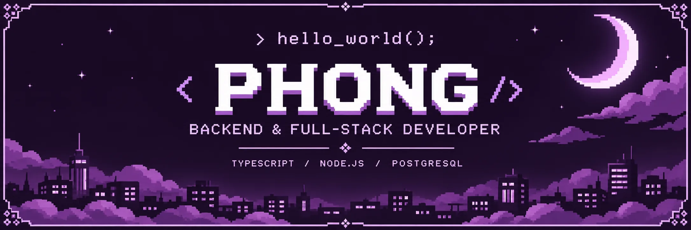

 
 

## ✦ About Me

I'm **Phong**, an Information Technology student focused on **backend development** and full-stack web applications.

I enjoy turning ideas into working software, designing RESTful APIs, and connecting frontend experiences with well-structured databases. My main stack is **TypeScript, Node.js, and PostgreSQL**.

Currently exploring **backend architecture, system design, authentication, authorization, and application security** through real-world projects.

## 🛠️ Tech Stack

### Languages & Backend

  
  &nbsp;
  
  &nbsp;
  

**Core:** `TypeScript` · `JavaScript` · `Node.js` · `Express.js`

### Frontend & Data

  
  &nbsp;
  
  &nbsp;
  
  &nbsp;
  

`React` · `Next.js` · `Tailwind CSS` · `PostgreSQL` · `Prisma` · `Redis`

### Developer Tools

  
  &nbsp;
  

`Git` · `GitHub` · `Docker` · `Postman` · `JWT` · `Socket.io`

### Technical Interests

`RESTful APIs` · `Database Design` · `Backend Architecture` · `Authentication & Authorization` · `Real-time Applications` · `System Design`

Other technologies I've explored

**Languages:** `Java` · `Python` · `C++`

**Backend:** `NestJS` · `FastAPI`

**Frontend:** `Vite` · `HTML5` · `CSS3`

**Data:** `MySQL` · `MongoDB` · `Supabase`

## 📂 Featured Projects

<table>
  <tr>
    <td width="50%" valign="top">
      
      <h3>Real Estate Transaction Platform</h3>
      

      
Property listings, interactive maps, and real-time messaging connecting buyers and sellers.

      
<code>Node.js</code> <code>PostgreSQL</code> <code>Socket.io</code>

      
    </td>
    <td width="50%" valign="top">
      
      <h3>Villa Booking Website</h3>
      

      
Villa discovery, availability checks, reservations, and online payments with VNPAY.

      
<code>Next.js</code> <code>Prisma</code> <code>VNPAY</code>

      
    </td>
  </tr>
</table>

<strong>Real Estate Transaction Platform — Features & technical highlights</strong>

A full-stack real estate platform that connects property buyers and sellers through listings, search, interactive maps, and real-time communication.

- Create, manage, search, and filter property listings.
- Interactive property map with Leaflet / React-Leaflet.
- Real-time messaging and notifications using Socket.io.
- JWT authentication with an access/refresh token flow.
- Saved properties, comments, and property reports.
- Admin management for users, properties, and reports.
- Redis caching and Cloudinary image management.

**Tech stack**

`Next.js` `React` `TypeScript` `Node.js` `Express.js`  
`PostgreSQL` `Prisma` `Redis` `Socket.io` `Cloudinary`  
`Leaflet` `TanStack Query` `Zustand` `Zod`

[Explore repository ↗](https://github.com/Longdev1701/Real_Estate_Transaction_Platform)

<strong>Villa Booking Website — Features & technical highlights</strong>

A full-stack villa booking platform for discovering accommodations, checking availability, making reservations, and completing online payments.

- Search and browse villas by location, capacity, amenities, and budget.
- Booking workflow with availability and reservation conflict checking.
- Online payment integration using VNPAY.
- Authentication and user profile management.
- Admin dashboard for accommodations, bookings, users, and reports.
- AI-assisted villa search using Groq API with a rule-based fallback.
- Consultation and transactional email integration with Resend.

**Tech stack**

`Next.js` `React` `TypeScript` `Tailwind CSS`  
`PostgreSQL` `Supabase` `Prisma`  
`VNPAY` `Groq API` `Resend`

[Explore repository ↗](https://github.com/Longdev1701/villa_booking-website)

## 🌱 Currently Learning

- Backend architecture and system design.
- Authentication, authorization, and application security.
- Improving engineering decisions through real-world projects.

## 📊 GitHub Analytics

 

## ✉️ Connect With Me

Let's talk about backend systems, web applications, or a project you're building.

---

**✦ Build. Learn. Improve. Repeat. ✦**

